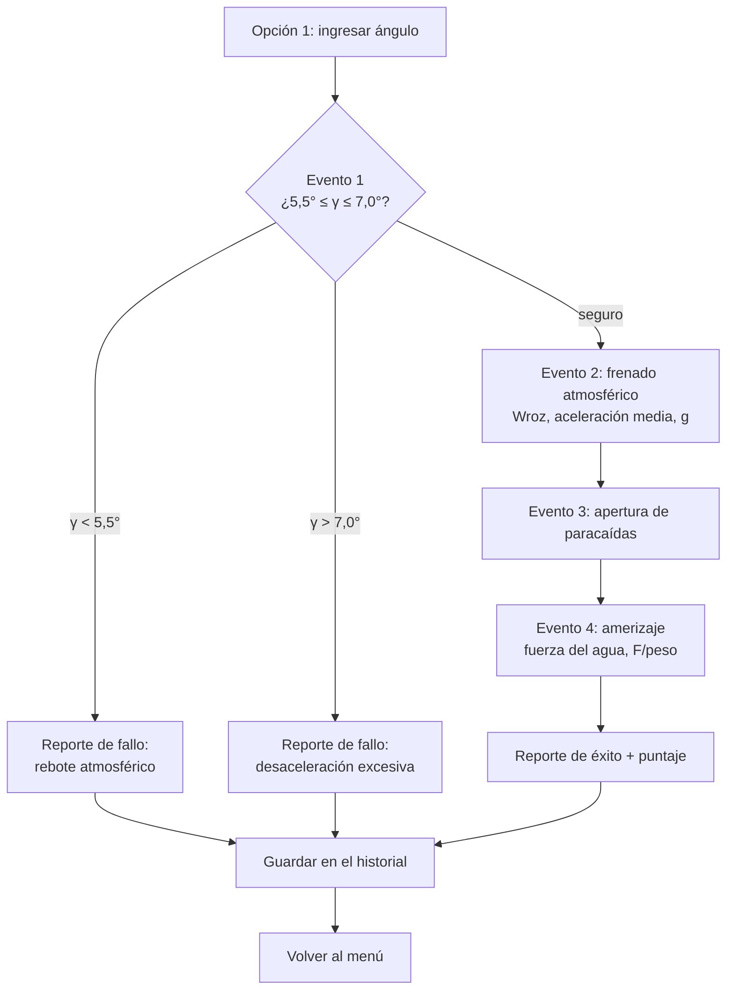
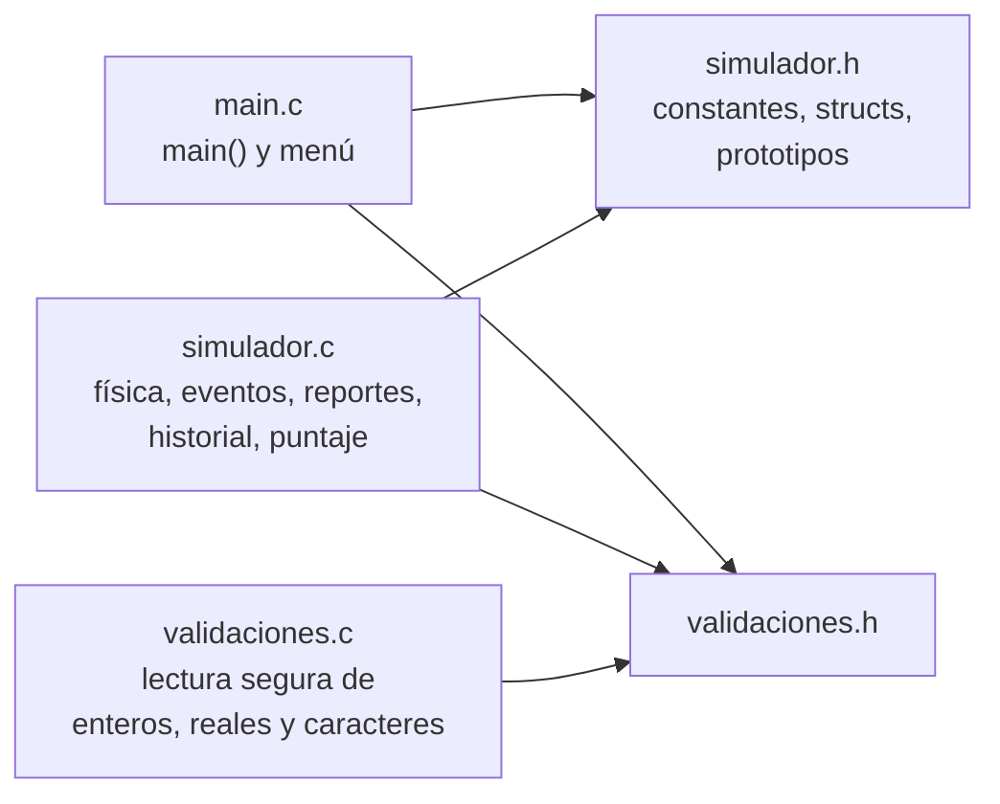

# Simulador de Misiones Artemis — Reingreso de Orion

Trabajo Práctico Integrador Final · Algoritmos y Estructuras de Datos
UTN Facultad Regional Resistencia · Ingeniería en Sistemas de Información

Simulador por consola, escrito en C, de la **Situación-Problema 4**: reingreso atmosférico, frenado aerodinámico, apertura de paracaídas y amerizaje de la cápsula Orion.

## link del repositorio y video 
https://github.com/santirod993-boop/simulador-artemis-c
https://www.youtube.com/watch?v=b0S0NYoDEg4

## a) Integrantes y comisión

| Integrantes        |  Legajo |
 solis tomas gabriel    29428
 Rodriguez Santiago     28890
 Zanier Fabricio        29653
 Boccalandro Fabricio   29495
 


**Comisión:** 

comision D k1.4

## b) Escenario y reglas del juego

### El escenario

Después del sobrevuelo lunar, el módulo de tripulación Orion (m = 10 400 kg) reingresa a la atmósfera a 11 000 m/s (Mach 32) desde 120 000 m de altura. El escudo térmico disipa su energía mediante el rozamiento del aire hasta llegar a 25 m/s, cuando se abren los paracaídas a 2 500 m. Finalmente, la cápsula amariza en el Océano Pacífico a 8 m/s y se hunde 1,50 m antes de flotar.

El programa responde las cuatro preguntas de la consigna, **a partir de los valores que ingresa el usuario**:

| Inciso | Qué calcula | Resultado con los datos de la consigna |
|---|---|---|
| a | Trabajo del rozamiento atmosférico entre 120 000 m y 2 500 m | −6,4118 × 10¹¹ J |
| b | Desaceleración media en 400 s, en m/s² y en g | −27,4375 m/s² · 2,80 g |
| c | Fuerza promedio del agua, en N y en múltiplos del peso | 323 890,67 N · 3,17 × peso |
| d | Consecuencias de un ángulo fuera de la ventana segura | Rebote atmosférico o desaceleración excesiva |

### Reglas del juego

1. El jugador es el **piloto**: en cada misión elige el **ángulo de reingreso γ**.
2. **Ventana segura: 5,5° ≤ γ ≤ 7,0°** (los extremos cuentan como seguros).
   - **γ < 5,5°** → **rebote atmosférico**: la cápsula vuelve al espacio. Misión fallida.
   - **γ > 7,0°** → **desaceleración y calentamiento excesivos**. Misión fallida.
3. Si el ángulo es seguro, la misión continúa con el frenado, los paracaídas y el amerizaje.
4. **Puntaje** (solo las misiones exitosas suman):
   - γ = 6,25° (centro de la ventana) → **100 puntos**
   - γ = 5,5° o 7,0° (bordes) → **50 puntos**
   - Entre el centro y los bordes, el puntaje baja de forma proporcional.
   - Misión fallida → **0 puntos**
5. Se guardan hasta **10 intentos** en el historial.
6. Al salir se muestra el **reporte final de desempeño**, con una calificación según el puntaje promedio:

| Promedio | Calificación |
|---|---|
| 90 o más | Excelente — comandante de misión |
| 75 o más | Muy bueno — piloto experto |
| 60 o más | Bueno — piloto |
| 50 o más | Regular — piloto en entrenamiento |
| Menos de 50 | Insuficiente — repetir el entrenamiento |

---

## c) Funcionamiento

### Menú principal

```
========= ARTEMIS - REINGRESO DE ORION =========
  1. Iniciar mision
  2. Ver datos de la mision
  3. Configurar parametros
  4. Ver historial
  5. Salir
================================================
```

| Opción | Qué hace |
|---|---|
| 1 | Pide el ángulo, simula los 4 eventos, muestra el reporte del intento y lo guarda en el historial |
| 2 | Muestra los 8 parámetros actuales junto a los de la consigna (`*` = modificado) |
| 3 | Permite restaurar la consigna o editar los 8 parámetros, con validación y confirmación S/N |
| 4 | Muestra los intentos guardados: ángulo, masa, estado, puntaje y detalle o causa del fallo |
| 5 | Sale y muestra el reporte final de desempeño |

### Simulación por eventos



### Validaciones de entrada

Todas las lecturas usan `fgets` (se lee la línea completa) y después `strtol`, `strtod` o el análisis de un carácter. El programa **nunca se cierra de forma inesperada ni entra en un bucle infinito**: ante un error muestra un mensaje y vuelve a preguntar.

| Entrada | Respuesta del programa |
|---|---|
| Letras donde va un número (`abc`) | `Error: eso no es un numero.` |
| Línea vacía | `Error: no escribiste nada.` (en la configuración, Enter conserva el valor actual) |
| Número con texto pegado (`6.5abc`, `2x`) | `Error: hay texto pegado al numero...` |
| Coma decimal (`6,5`) | `Error: usa punto decimal, no coma (ej: 6.5).` |
| `nan`, `inf`, `1e999` | Mensaje específico para cada caso |
| Fuera de rango | `Error: debe ser mayor que X y menor que Y.` |
| Más de una letra en una respuesta S/N | `Error: escribi una sola letra.` |
| Otra letra que no sea S/N | `Error: responde S o N.` |
| Fin de la entrada (Ctrl+Z / Ctrl+D) | Cierra el programa de forma ordenada y muestra el reporte final |

**Controles cruzados al configurar:** velocidad de paracaídas < velocidad inicial, velocidad de impacto < velocidad de paracaídas, y altura de despliegue < altura inicial.

---

## Arquitectura



| Archivo | Módulo (según la consigna) | Contenido |
|---|---|---|
| `main.c` | Principal | Solo `main()`, el menú y la inicialización |
| `simulador.h` | Cabecera | `#define`, `struct`/`typedef` y prototipos públicos |
| `simulador.c` | Lógica | Cálculos físicos, configuración, eventos, reportes, historial y puntaje |
| `validaciones.h` / `.c` | Validaciones e interfaz | Lectura segura de enteros, reales y caracteres, y mensajes de error |
| `Makefile`, `compilar.bat` | — | Scripts de compilación |

### Estructuras de datos

| Estructura | Para qué se usa |
|---|---|
| `Configuracion` (`struct`) | Los 8 parámetros físicos de la misión |
| `ResultadoMision` (`struct`) | Todo lo que produce un intento: ángulo, éxito o fallo, causa, resultados físicos, puntaje y una copia de la configuración usada |
| `EstadisticasMision` (`struct`) | El resumen del reporte final |
| `ResultadoMision historial[10]` (arreglo) | Los intentos guardados |

**Punteros:** las funciones reciben punteros para modificar datos de `main` (`configurarParametros(&configuracion)`, `guardarResultado(historial, &cantidad, &resultado)`) y punteros `const` para solo leer (`mostrarHistorial`, reportes). `guardarResultado` controla el límite del arreglo antes de escribir, así que nunca se escribe fuera de él.

### Modelo físico

| Magnitud | Fórmula |
|---|---|
| Trabajo del rozamiento | `Wroz = ½·m·(vf² − vi²) + m·g·(hf − hi)` (teorema del trabajo y la energía mecánica) |
| Aceleración media | `a = (vf − vi) / Δt` |
| Aceleración en g | `|a| / g` |
| Fuerza del agua | `F = m·g + m·v² / (2·d)` |
| Fuerza / peso | `F / (m·g)` |

**Simplificaciones:** g = 9,81 m/s² constante (a 120 km la gravedad real es un 3,7 % menor, lo que cambia Wroz en apenas un 0,035 %). La desaceleración media es un valor promedio, no el pico real del descenso.

---

## d) Compilación y ejecución

Hace falta tener **gcc** instalado. En Windows viene con **Code::Blocks** en la versión que dice *mingw-setup*.

**Con Make (Linux / Mac / Git Bash):**

```bash
make          # compila
make run      # compila si hace falta y ejecuta
make clean    # borra los archivos generados
```

En Windows con el MinGW de Code::Blocks, el comando es `mingw32-make` (desde cmd).

**Con el script de Windows:** doble clic en `compilar.bat`. Compila, avisa si hay errores y ejecuta el programa.

**A mano:**

```bash
gcc -std=c99 -Wall -Wextra -pedantic main.c simulador.c validaciones.c -o artemis -lm
./artemis        # Linux / Mac
artemis.exe      # Windows
```

**Con Code::Blocks:** crear un proyecto *Console application → C*, agregar los 5 archivos `.c`/`.h` (y quitar el `main.c` de ejemplo) y apretar F9.

---

## Decisiones de diseño

| Decisión | Motivo |
|---|---|
| El ángulo se acepta entre 0° y 90° (excluidos) | Fuera de ese rango no representa un reingreso; adentro, el programa clasifica si la misión sobrevive |
| Un ángulo peligroso es un dato **válido** que produce una **misión fallida**, no un error de entrada | Permite estudiar el inciso d |
| Límites: masa < 100 000 kg, velocidad inicial < 20 000 m/s, altura inicial < 200 000 m, tiempo < 3 600 s, profundidad < 10 m (todos > 0) | Proteger las divisiones y evitar valores absurdos |
| Controles cruzados entre velocidades y alturas | Garantizan que la cápsula frene y baje (Wroz y aceleración negativos) |
| Configuración sobre una copia y confirmación S/N | Si la carga se interrumpe o se descarta, se conserva la configuración anterior |
| Historial de **10** intentos; si se llena, se simula pero no se guarda | Arreglo estático de tamaño fijo, sin escribir fuera de sus límites |
| Puntaje de 50 a 100 según la cercanía al centro de la ventana | Agregar un desafío de precisión al simulador |
| Mensajes sin tildes | La consola de Windows suele mostrar mal los caracteres acentuados |

---

## Casos de prueba

| Entrada | Resultado esperado |
|---|---|
| `1` → `6.25` | Misión exitosa, 100 puntos |
| `1` → `6.5` | Misión exitosa, Wroz = −6,4118e+11 J, 2,80 g, 323 890,67 N, 3,17 × peso, 83 puntos |
| `1` → `5` | Fallo por rebote atmosférico, 0 puntos |
| `1` → `7.5` | Fallo por desaceleración excesiva, 0 puntos |
| `1` → `abc`, `6,5`, `nan`, `0`, `90` | Un mensaje de error distinto para cada uno; vuelve a preguntar |
| `3` → velocidad inicial `20` y velocidad de paracaídas `25` | `Error: debe ser mayor que 0 y menor que 20.` |
| 12 misiones seguidas | Se guardan 10; los intentos 11 y 12 avisan que el historial está lleno |
| `5` | Reporte final de desempeño |

---

## e) Registro del uso de Inteligencia Artificial
     ### Consultas realizadas

#### Prompts principales (desarrollo del programa)

| # | Prompt (resumido) | Qué se obtuvo |
|---|---|---|
| 1 | "Ayudame a programar paso a paso mi TP de Algoritmos y Estructuras de Datos de la UTN. Estoy aprendiendo C. Mi escenario es el 4 de Artemis […] El programa final tiene que funcionar por consola y tener menú, simulación por eventos, reporte final, condicionales, ciclos, funciones, arreglos, punteros, validaciones de entrada y archivos .c y .h […] Para cada etapa mostrame: la lógica en pseudocódigo, qué archivo debo crear o modificar, el código y una explicación, y el comando para compilar y las pruebas." | Plan de trabajo por etapas y resultados de referencia |
| 2 | "Actuá como profesor de física con experiencia en mecánica clásica y reingreso atmosférico. Vamos a resolver la Situación-Problema 4 de forma analítica y paso a paso […] Mostrá cada fórmula, hacé el análisis dimensional, cuidá el signo del trabajo y de las fuerzas." | Método de resolución de los incisos |
| 3 | "Resolvé el inciso (a) […] usá el teorema del trabajo y la energía mecánica. Calculá por separado ΔEc y ΔEp […] Explicá qué significa el signo del resultado y a dónde va esa energía." | Wroz ≈ −6,41 × 10¹¹ J |
| 4 | "Resolvé el inciso (b): la aceleración media […] Expresá el resultado en m/s² y en múltiplos de g. Explicá el signo negativo y qué sentirían los astronautas." | a ≈ −27,44 m/s² ≈ 2,80 g |
| 5 | "Resolvé el inciso (c) […] por dos métodos y verificá que coincidan: trabajo y energía, y leyes de Newton con cinemática." | F ≈ 323 890 N ≈ 3,17 × peso |
| 6 | "Resolvé el inciso (d) […] explicá por qué ocurre el rebote con γ < 5,5° y por qué la desaceleración y el calentamiento se vuelven peligrosos con γ > 7,0°. Cerrá con una tabla que vamos a usar en los mensajes del programa." | Tabla de mensajes del ángulo |
| 7 | "Etapa 1. Creá únicamente main.c con un menú que se repita con do while y use switch […] Leé la opción con fgets y strtol […] Si escribo letras, una línea vacía, un número con texto pegado o una opción fuera del menú, mostrá un mensaje y volvé a pedirla." | Menú y lectura validada de enteros |
| 8 | "Etapa 2. Hacé que la opción 1 pida el ángulo de reingreso. Creá una función clasificarAngulo […] Leé el ángulo con strtod. Rechazá texto, números con basura al final, NaN e infinito." | Lectura de reales y clasificación del ángulo |
| 9 | "Etapa 3. Creá fisica.h y fisica.c con funciones que reciban parámetros double y devuelvan el resultado. Definí la gravedad como macro […] Explicame qué va en el .h, qué en el .c y qué hace el guardia #ifndef." | Funciones de cálculo físico |
| 10 | "Etapa 4. Creá una función iniciarMision […] Organizá la misión en cuatro eventos […] Si el ángulo está fuera de la ventana, terminá ese intento, mostrá un reporte de fallo con la causa y volvé al menú." | Simulación por eventos |
| 11 | "Etapa 5. Ampliá el menú […] Agrupá los parámetros en un struct Configuracion […] guardá cada intento en un arreglo de hasta 10 resultados […] Usá un puntero para modificar la configuración y otro para actualizar el contador." | Configuración editable e historial |
| 12 | "Mirá, fijate bien lo que hay que tener, esta es la actividad completa." (adjuntando la consigna) | Lista de requisitos faltantes y plan de etapas 6 a 9 |
| 13 | "Vamos a la etapa 6 / 7 / 8 / 9" | Reorganización en main/simulador/validaciones, edición de los 8 parámetros, puntaje y reporte final, Makefile y README |

> Nota: en las etapas 6 a 9 el contenido de cada etapa lo propuso la IA a partir de la revisión de la consigna (prompt 12); el grupo eligió avanzar con esas propuestas.


**Herramientas utilizadas:** Claude (Anthropic) y gemini 

### Para qué se usó

- Resolver analíticamente los incisos a, b, c y d del escenario 4, para tener valores de referencia contra los cuales probar el programa.
- Planificar el desarrollo por etapas y generar código inicial en C para cada etapa.
- Explicar conceptos de C: `fgets`/`strtol`/`strtod`, `switch` y `break`, punteros, `struct`, archivos `.h`/`.c` y guardias de inclusión.
- Proponer casos de prueba y resultados esperados.
- Resolver problemas de compilación (gcc no encontrado en Windows, cómo compilar varios archivos).

### Consultas realizadas

| # | Consulta (resumen del prompt) | Qué se obtuvo |
|---|---|---|
| 1 | Plan del TP por etapas, con pseudocódigo, archivos, código, explicación y pruebas | Plan de etapas y resultados de referencia |
| 2 | Resolución analítica de los incisos a, b, c y d actuando como profesor de física | Desarrollo con fórmulas, unidades y signos |
| 3 | Etapa 1: menú con `do-while`, `switch`, `fgets` y `strtol`, validando la opción | Menú y lectura validada |
| 4 | Etapa 2: pedir el ángulo con `strtod`, rechazar texto, NaN e infinito, y clasificarlo | `clasificarAngulo` y lectura de reales |
| 5 | Etapa 3: funciones físicas en `.h`/`.c` con `#define G` | Módulo de cálculos |
| 6 | Etapa 4: simulación en cuatro eventos con reporte de éxito o fallo | `iniciarMision` y eventos |
| 7 | Etapa 5: `struct Configuracion`, historial de 10 intentos y punteros | Configuración editable e historial |
| 8 | Etapa 6: reorganizar en `main.c`, `simulador` y `validaciones` según la consigna, y leer caracteres | Estructura modular final y confirmación S/N |
| 9 | Etapa 7: editar los 8 parámetros con controles cruzados | Configuración completa |
| 10 | Etapa 8: puntaje y reporte final de desempeño | Puntaje, estadísticas y reporte |
| 11 | Etapa 9: Makefile, script de compilación y este README | Archivos de compilación y documentación |
| [COMPLETAR] | [Otras consultas del grupo] | |

### Cómo se validó y adaptó el código

primero dictamos las bases como realizar el codigo y con que propts la ia nos ayudaria a armar todo, definimos la idea y el menu y fijamos una situacion especifica que la ia tendria que interpretar como si fuera una persona experta en la materia, cada integrante se centro en bucar maneras mas sencillas de armar cada parte del codigo, a travez tambien de la realizacion de pseudocodigo dictado por la catedra

### Comprensión del código
cada integrante se centro en estudiar cada parte de la estructura de como funciona el codigo, no solo a nivel pseudocodigo sino viendo tambien la estrunctura de c a detalle, plasmando los conociemientos en el video proporcionado 
